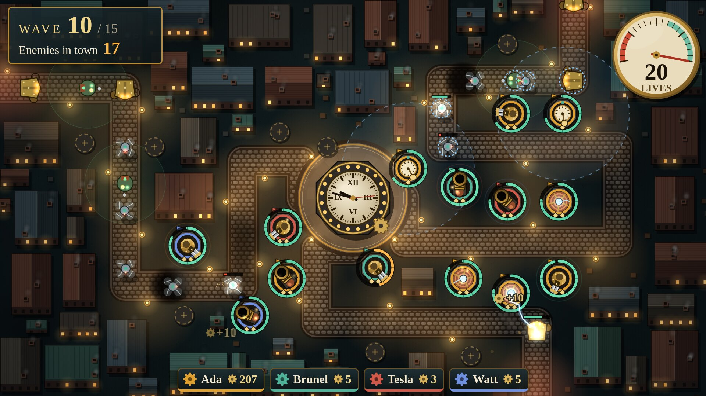
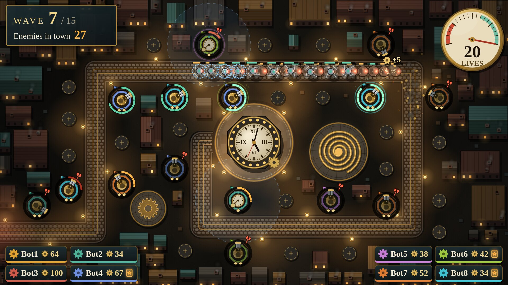
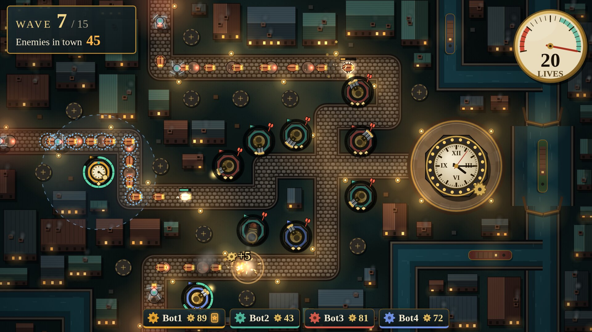
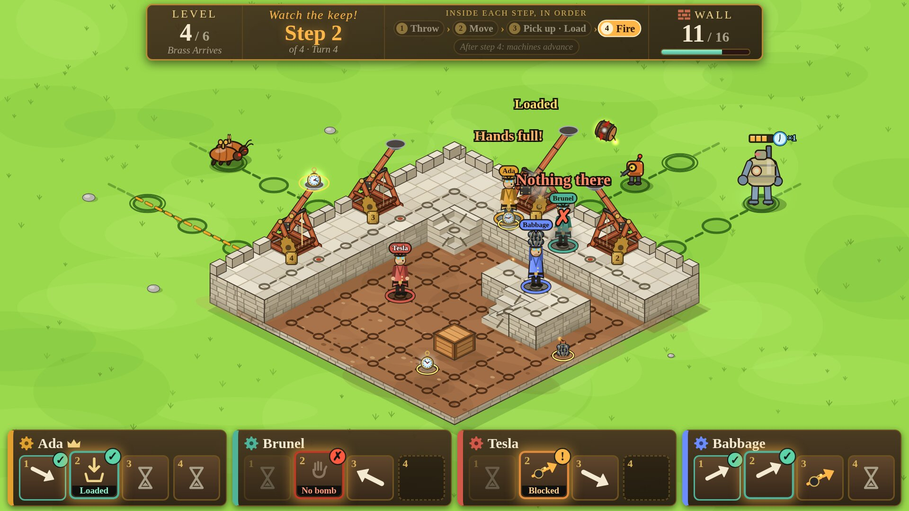
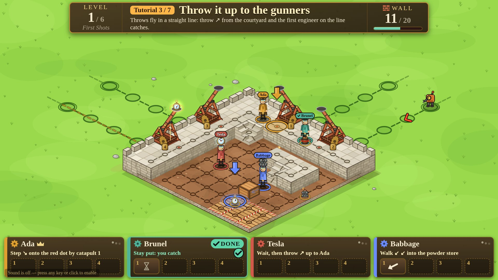
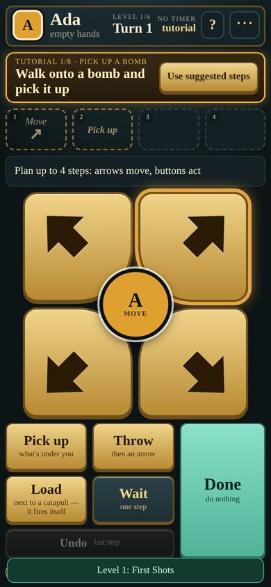
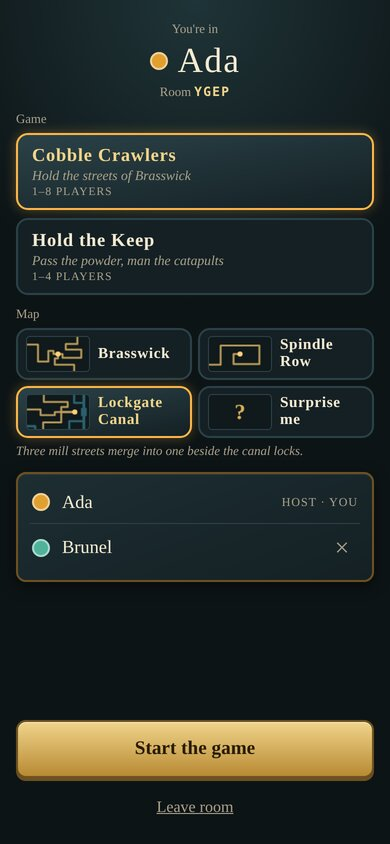

# Clocktower

Co-op party games for a living room, in the style of Jackbox games: the TV shows the action, and everyone plays from their own phone. The games share one setting, the clockwork town of Brasswick and the scrap-metal machines that keep marching on it. It is one Go binary: no accounts, no app to install, no front-end build step.

## The games

The first player to join is the host and picks the game in the lobby.

| Game | Players | What you do |
|---|---|---|
| **Cobble Crawlers** | 1–8 | Real-time tower defence. Build clockwork towers along the streets and keep them wound by hand for 15 waves. |
| **Hold the Keep** | 1–4 | Simultaneous turns. Everyone plans four steps out loud, then all the steps play at once: pass the powder, load the catapults. *Work in progress; off unless enabled.* |

### Cobble Crawlers

Each player owns towers on shared plots, earns cogs for kills, and has to crank their towers on the phone to keep them firing. Between waves there is a short build phase; after odd waves everyone picks a perk. The team shares 20 lives.

There are three maps, picked by the host or left on "Surprise me":

- **Brasswick**: three crooked streets meet at the old clock square.
- **Spindle Row**: one long street wound like a mainspring around the clock.
- **Lockgate Canal**: three mill streets merge into one beside the canal locks.

Bigger groups get more plots and tougher machines.

| | |
|---|---|
|  |  |

Full rules: [docs/GAMEPLAY.md](docs/GAMEPLAY.md).

### Hold the Keep

Machines advance down four lanes towards the keep. Bombs appear in the powder store in the courtyard; the catapults are up on the ramparts. Each turn every engineer queues up to four steps on their phone (move one tile, pick up, throw in a straight line, load, wait). Plans show live on the TV, then everybody's step 1 plays together, then step 2, and so on. A thrown bomb is caught by the first engineer in its path, so the fastest way to arm a catapult is a chain of hands, and the game is mostly people shouting "no, throw on step two!".

The phone is a controller with no map: eyes stay on the TV. A game opens with a guided tutorial in which every player picks up, throws, catches and loads once; the host can skip it.

| | |
|---|---|
|  |  |

This game is still being tuned and is only offered when the server runs with `-wip-modes` (or `CLOCKTOWER_WIP_MODES=1`). Rules and design: [docs/CATAPULT_COOP.md](docs/CATAPULT_COOP.md).

## Quick start

1. Install Go (version in `go.mod`) and clone this repository.
2. `go run ./cmd/clocktower` (add `-wip-modes` to include Hold the Keep).
3. Open `http://localhost:8080/tv` on the big screen.
4. Players scan the QR code with their phones (or open the address shown and type the room code).
5. The host picks the game (and the map), then presses Start.

A container image is published at `ghcr.io/backslasher/clocktower`; see [docs/RUNNING.md](docs/RUNNING.md).

## For the host

- **Pause** the game, **end** it, or **remove a player** who has wandered off, from the menu on your phone.
- **Skip the wait**: start the next wave (Cobble Crawlers) or play the turn now (Hold the Keep) without waiting for the timer.
- Players can join, leave and rejoin mid-game. On the TV, press Back twice to quit.

## Documentation

- [docs/GAMEPLAY.md](docs/GAMEPLAY.md): how Cobble Crawlers plays, for players and hosts. Towers, enemies, cranking, perks.
- [docs/CATAPULT_COOP.md](docs/CATAPULT_COOP.md): Hold the Keep rules, levels and design notes.
- [docs/RUNNING.md](docs/RUNNING.md): running, hosting, deploying, and developing it.
- [docs/DESIGN.md](docs/DESIGN.md): design rationale and balance targets.
- [docs/PROTOCOL.md](docs/PROTOCOL.md): architecture and websocket protocol.
- [web/modes/README.md](web/modes/README.md): how a game mode plugs into the TV and phone shells.
- [CREDITS.md](CREDITS.md): audio credits and licences.
