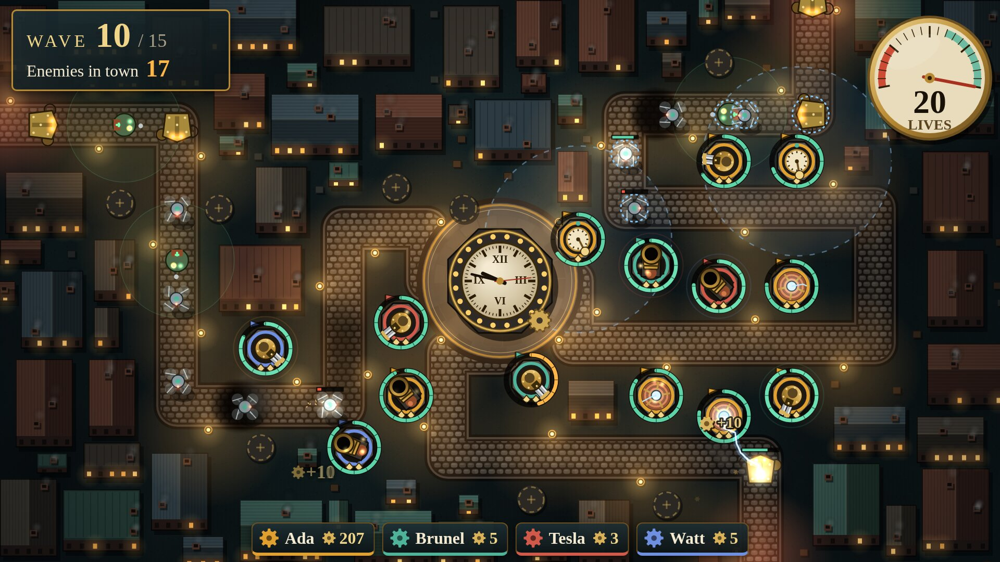
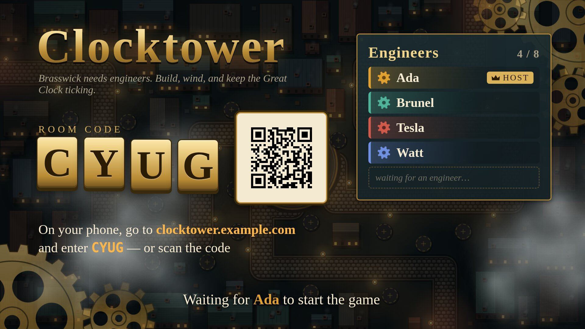
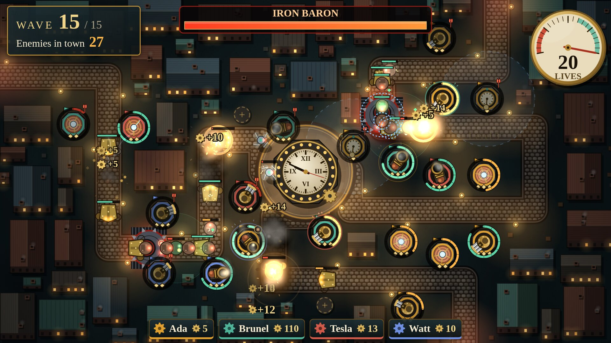
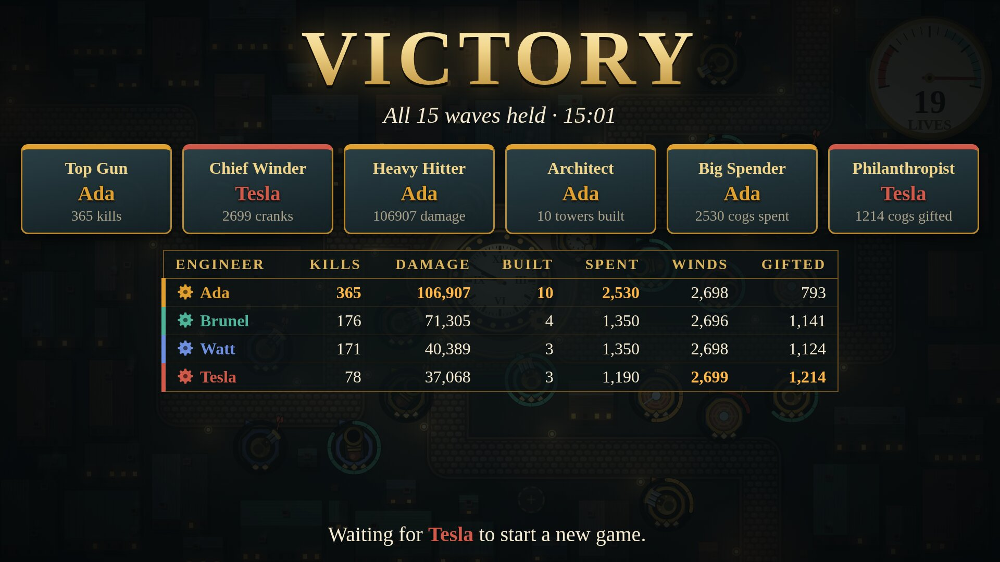
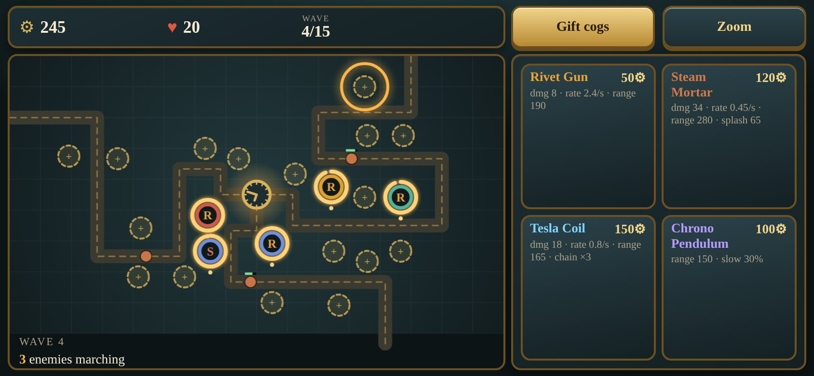
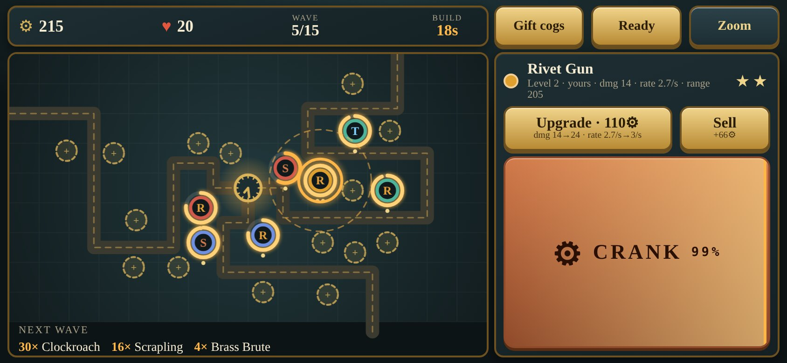
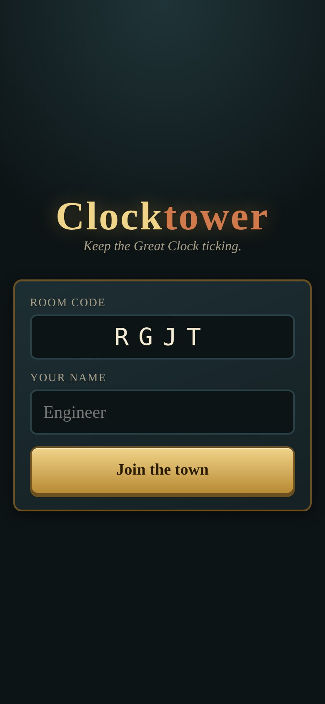

# Clocktower

A co-op steampunk tower defence for a living room, in the style of Jackbox games. The TV shows the town of Brasswick and a horde of scrap-metal machines marching on its Great Clock. Up to eight players join from their phones, build and upgrade clockwork towers, and keep them wound by hand to hold out for 15 waves.

It is one Go binary. There are no accounts, no app to install and no build step for the front end: the TV opens a page, the phones open another, and that is the whole setup.



## How a game works

**Lobby.** Open `/tv` on the big screen. It shows a four-letter room code and a QR code. Players scan the code (or open the address and type the code), enter a name and join. The first player to join is the host and presses Start. Players can join mid-game and get a catch-up purse; a phone that sleeps or reloads rejoins as the same player.



**Build phase.** Before each wave there is a 20 second build phase, skipped early if everyone taps Ready. The TV previews what is coming. Everyone spends cogs (the currency) on towers and upgrades. There are about 22 fixed plots on the map.

**Wave.** Enemies walk the streets toward the clock tower. Each one that arrives costs lives; the team shares 20. Building and upgrading carry on during the wave, and so does winding.

**Winding.** Every tower has a spring with a tension between 0 and 1 that decays over about 25 seconds. A wound tower fires up to 75% faster (the Chrono Pendulum widens its slowing radius instead). Any player can wind any tower: select it on your phone and mash the CRANK button. During a wave this is what everyone's thumbs are busy with, and it is where the shouting across the sofa happens.

**Shared and split.** Lives and the battlefield are shared. Every kill pays all connected players equally, so nobody fights over last hits, but each player has their own purse and decides what to build. Anyone can upgrade any tower (paying from their own purse); only the builder can sell it, for a 60% refund. Players can also gift cogs to each other.

**Waves 8 and 15** are boss waves, led by the Iron Baron.



**End.** The victory or defeat screen shows per-player stats and awards (Top Gun, Chief Winder, Heavy Hitter, Architect, Big Spender, Philanthropist). The host can send everyone back to the lobby for another round. Enemy health scales up slightly with each extra player, and the starting purse is split so a team opens with a handful of basic towers whatever its size.



### On the phone

The controller is meant to be held in landscape: a small map on the left, and on the right either the build menu or the selected tower.

| Empty plot selected | Tower selected |
|---|---|
|  |  |

Join screen on a phone in portrait:



### Towers

Each tower has three levels. Costs below are build / upgrade to level 2 / upgrade to level 3, in cogs.

| Tower | Cost | Role |
|---|---|---|
| Rivet Gun | 50 / 60 / 110 | Fast single-target fire; hits ground and air. |
| Steam Mortar | 120 / 130 / 220 | Slow, long range, splash damage. Cannot hit flyers. |
| Tesla Coil | 150 / 160 / 260 | Chain lightning over 3, 4 then 5 targets; ignores armour. |
| Chrono Pendulum | 100 / 110 / 180 | No damage. Slows enemies in its radius by 30, 40 then 50%. Slows do not stack; bosses are slowed at half strength. |

### Enemies

| Enemy | Notes |
|---|---|
| Scrapling | Baseline walker. |
| Clockroach | Fast and fragile; comes in swarms. |
| Brass Brute | Slow, lots of HP, armoured (flat damage reduction per hit); costs 2 lives. |
| Aero-Drone | Flies, so mortars cannot target it. |
| Tinker | Repairs nearby enemies over time. Kill it first. |
| Iron Baron | Boss. Huge HP and armour; costs 10 lives if it arrives. |

## Hosting it

Requirements: Go (see `go.mod` for the version) to run from source. The front end is embedded in the binary.

```sh
go run ./cmd/clocktower
```

Then open `http://<host>:8080/tv` on the TV or any big screen. Players scan the QR code with their phones. Everyone needs to be able to reach the server: on a home network use the machine's LAN address; for friends elsewhere, put it on the internet.

To build a binary instead: `go build -o bin/clocktower ./cmd/clocktower`.

### Configuration

| Env var | Flag | Default | Meaning |
|---|---|---|---|
| `CLOCKTOWER_ADDR` | `-addr` | `:8080` | Listen address. |
| `CLOCKTOWER_BASE_URL` | `-base-url` | unset | Public base URL used for the QR code and the join address on the lobby screen, e.g. `https://clocktower.example.com`. If unset it is derived from the TV's request (`X-Forwarded-Proto` / `X-Forwarded-Host` if present, otherwise the scheme and `Host`). |
| | `-dev` | off | Serve `web/` from disk instead of the embedded copy. |

### On the internet

Clocktower is designed to be exposed publicly. There are no accounts and no auth: a room is just a four-letter code, and the server validates and rate-limits all input and caps rooms and connections. Put it behind any reverse proxy that passes websockets (the game uses `/ws`) and set `CLOCKTOWER_BASE_URL` to the public address so the QR code points at the right place. `GET /healthz` returns `ok` for health checks. Rooms with nobody connected are dropped after 10 minutes.

### Container

An image is published to GitHub Container Registry on every push to `main`, tagged `latest`, `main` and the full commit SHA:

```sh
docker run --rm -p 8080:8080 \
  -e CLOCKTOWER_BASE_URL=https://clocktower.example.com \
  ghcr.io/backslasher/clocktower:latest
```

The image is a static binary on a distroless base, runs as a non-root user and listens on port 8080. To build it yourself: `docker build -t clocktower .`

## Development

```
cmd/clocktower/   the server: flags/env, HTTP
cmd/ctbot/        dev tool: joins a room as bot players and plays
internal/game/    pure simulation (no networking), unit-tested; balance numbers are in defs.go
internal/room/    rooms, codes, sessions, per-room loop, websocket fan-out
internal/server/  HTTP routes, websocket upgrade, QR endpoint
web/              embedded front end: phone/ (controller), tv/ (big screen), shared/
tools/shot.mjs    screenshot helper for headless Chromium
docs/             DESIGN.md (what the game is) and PROTOCOL.md (wire protocol)
```

The front end is plain ES modules with no build step and makes no external network requests. The game art is currently all drawn in code.

```sh
go vet ./...
go test ./...
```

Run with `-dev` to serve `web/` from disk, so front-end edits show on reload. Add `-speed N` (a multiplier on simulation time) to fast-forward towards the late waves:

```sh
go run ./cmd/clocktower -addr :8096 -dev -speed 3
```

`ctbot` fills a room with bots that build, upgrade and wind. Open `/tv` to get a room code, then:

```sh
go run ./cmd/ctbot -url http://localhost:8096 -room ABCD -n 3 -names Ada,Brunel,Tesla
```

Without `-room` it creates a room itself via a TV connection. Other flags: `-skill good|bad`, `-taps` (winding taps per second), `-no-start`, `-loop` (restart and play again after the game ends), `-name-prefix`, `-q`; see `ctbot -h`.

The screenshots in `docs/img/` were taken from a live game this way, using `tools/shot.mjs` against a headless Chromium started with `--remote-debugging-port` (run `node tools/shot.mjs` without arguments for usage; `--mobile` emulates a phone). The TV page also has a dev-only `?demo=wave|build|boss|won|lost` mode for previewing states without playing.

Read [docs/DESIGN.md](docs/DESIGN.md) for the game design and [docs/PROTOCOL.md](docs/PROTOCOL.md) for the architecture and websocket protocol; the protocol file is the contract between the server and both clients, so change it first if something must change.
