# How Clocktower plays

Clocktower is a co-op game for one to eight people. One screen (the TV) shows the town of Brasswick; every player uses their own phone as a controller. The team shares 20 lives and has to hold out for 15 waves of scrap-metal machines marching on the Great Clock.

This page is for players and whoever is hosting. To get the game running, see [RUNNING.md](RUNNING.md).

## Joining

Open `/tv` on the big screen. It shows a four-letter room code and a QR code.

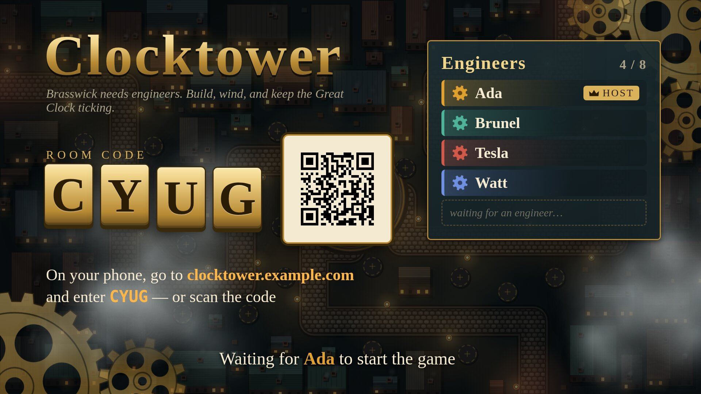

- **Join:** scan the QR code, or open the address shown and type the room code. Enter a name (1 to 12 characters) and join.
- **Host:** the first player to join is the host and presses Start. If the host leaves, host passes to whoever has been connected longest.
- **Rejoining:** a phone that sleeps, locks or reloads comes back as the same player, with its purse and towers intact. The phone remembers who it was; there is nothing to type.
- **Joining mid-game:** allowed (up to eight players in total). A latecomer gets a catch-up purse based on what the team already holds, and their first perk offer comes at the next wave clear.

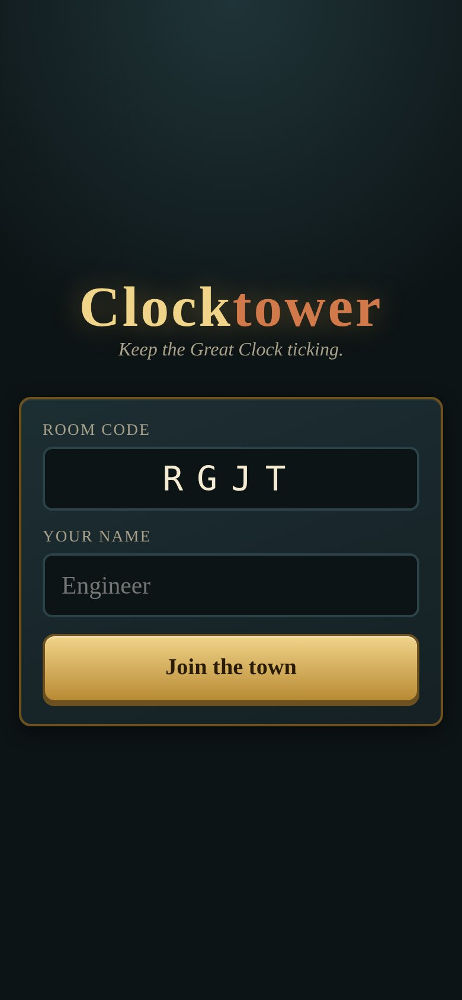

## The phone controller

Hold the phone in landscape. A small map is on the left. On the right you see the build menu when an empty plot is selected, or the tower controls when a tower is selected.

| Empty plot selected | Tower selected |
|---|---|
| 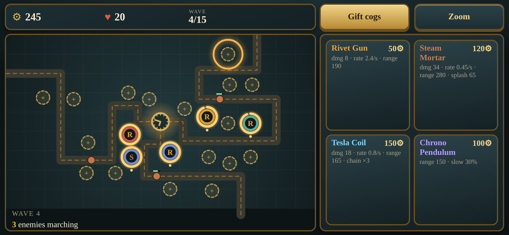 | 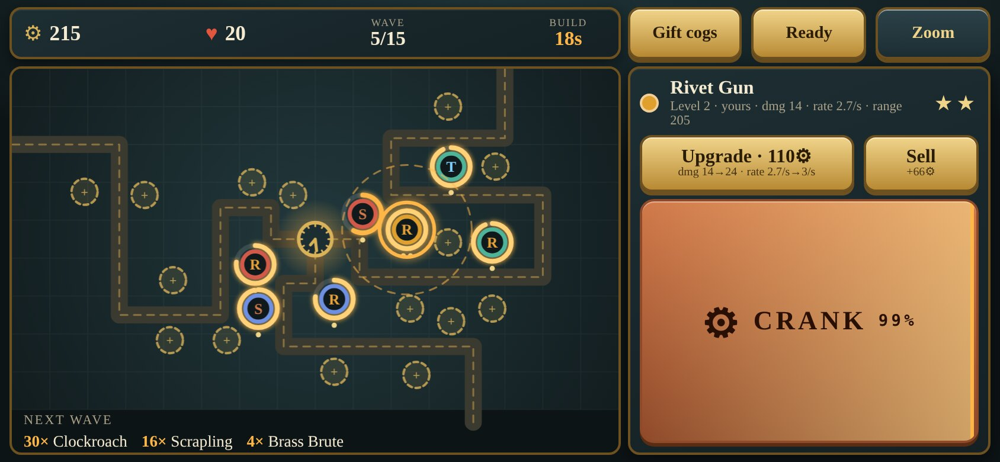 |

Tap a plot, tap a tower to build it. Tap a tower to upgrade, sell or crank it.

## Build phase and Ready

Before each wave there is a 20 second build phase. The TV previews what is coming. Spend your cogs (the currency) on towers and upgrades. There are about 22 fixed plots on the map. Building and upgrading also work during a wave.

Tap **Ready** when you are done. The wave starts early once every active player is ready (see [Idle players](#idle-players)); before wave 1 it waits for everyone or the timer.

## Waves and lives

Enemies walk the streets toward the clock tower. Each one that arrives costs lives: most cost one, a Brass Brute costs two, an Iron Baron costs ten. The team shares 20 lives. Lose them all and the game is lost; clear wave 15 and it is won. A full game takes about 17 minutes.

## Cranking

Every tower has a spring. Its tension runs between 0 and 1 and runs down over about 25 seconds. A wound tower fires up to 75% faster; the Chrono Pendulum widens its slowing radius instead.

Any player can wind any tower: select it on your phone and mash the CRANK button. A ring around the tower on the TV shows its tension, and a key appears when it is nearly run down. During a wave this is what everyone's thumbs are busy with, and it is where the shouting across the sofa happens ("someone wind the mortar!"). A team that never winds can still win, but loses far more often.

## Money

- **Bounties are split.** Every kill, and the bonus for clearing a wave, pays all active players equally, so nobody fights over last hits. Each player still has their own purse and decides what to build.
- **Gifting.** You can send cogs to another player from your phone.
- **Upgrading.** Anyone can upgrade any tower, paying from their own purse.
- **Selling.** Only the player who built a tower can sell it. The refund is 60% of everything spent on it.
- **Colours.** Each tower carries its builder's colour on the TV.

The starting purse is split between players so that a team opens with a handful of basic towers whatever its size. Enemy health scales up slightly with each extra player.

## Idle players

A friend who wanders off should not drain the team's income into a purse nobody spends. A player counts as active while connected and having sent any command (build, upgrade, sell, wind, gift or Ready) during the current wave cycle or the one before; a cycle is a build phase plus its wave. Everyone is active for wave 1.

- Bounties and wave-clear bonuses go to active players only. If nobody is active they go to all connected players.
- The Ready check ignores idle players, so they cannot hold up a wave.
- One action per wave keeps you counted, and any action brings you straight back. Even tapping Ready counts.
- Going idle does not make enemies weaker. The cost of an absent friend is their missing hands on the crank.
- An idle player keeps what they already had, and can be gifted cogs when they return.

## Towers

Each tower has three levels. Costs are in cogs: build, then upgrade to level 2, then upgrade to level 3. Left image is level 1, right is level 3.

| Level 1 / 3 | Tower | Cost | Role and advice |
|---|---|---|---|
| 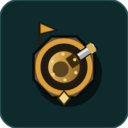 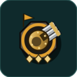 | **Rivet Gun** | 50 / 60 / 110 | Fast single-target shots; hits ground and air. The cheap all-rounder and the best first build. |
| 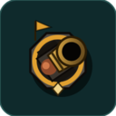 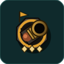 | **Steam Mortar** | 120 / 130 / 220 | Slow, long range, splash damage. Cannot hit flyers. Put it where enemies bunch up, and keep it wound. |
| 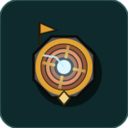 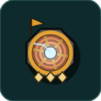 | **Tesla Coil** | 150 / 160 / 260 | Chain lightning over 3, 4, then 5 targets; ignores armour. The answer to Brass Brutes. |
| 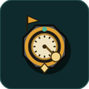 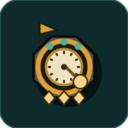 | **Chrono Pendulum** | 100 / 110 / 180 | No damage. Slows enemies in its radius by 30, 40, then 50%. Slows do not stack (the strongest wins) and bosses are slowed at half strength. Winding widens its radius. Place it ahead of your damage towers. |

## Enemies

| Image | Enemy | Why it is dangerous | Counter |
|---|---|---|---|
| 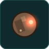 | **Scrapling** | The baseline walker; dangerous in numbers. | Anything. |
| 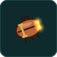 | **Clockroach** | Fast and fragile; arrives in swarms that slip past single-target fire. | Mortar and Tesla splash and chains; a Chrono Pendulum. |
| 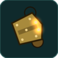 | **Brass Brute** | Slow and tough, and armoured: each hit is reduced by a flat amount, so weak shots do very little. Costs 2 lives. | Tesla Coils (ignore armour); upgraded Rivet Guns and Mortars. |
| 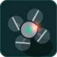 | **Aero-Drone** | Flies, so Steam Mortars cannot target it. | Rivet Guns and Tesla Coils. |
| 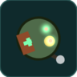 | **Tinker** | Repairs nearby enemies over time. | Kill it first. |
| 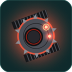 | **Iron Baron** | Boss. Huge health and armour; costs 5 lives if it arrives. | Everything at once, fully wound, with Chrono Pendulums slowing it. |

## Bosses

Waves 8 and 15 are boss waves led by the Iron Baron. Wave 8 has one and is the hardest moment of the first half; wave 15 has two.

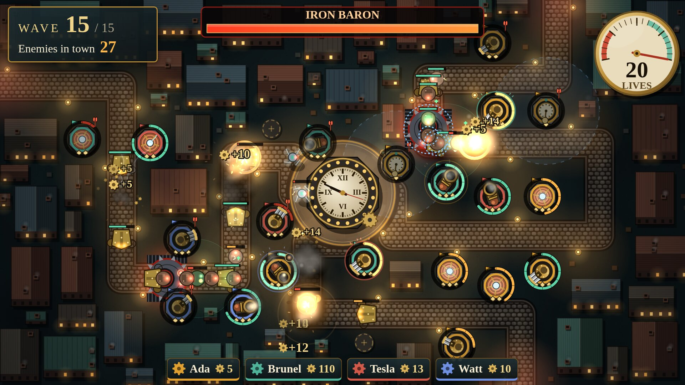

<!-- PERKS-BEGIN: remove everything from here to PERKS-END if the perks feature is dropped. -->
## Perks

When you clear a wave, every connected player is offered a choice: your phone shows three random perk cards and you keep one. This happens after waves 1 to 14, not after the last. The offer stays open through the next build phase and wave; if you have not picked by the time that wave is cleared, it is replaced by a new one. Picking is never required and never holds up Ready.

Perks are personal: they change your towers, your cranking or your purse, not your teammates'. They stack, so a player can drift into a Rivet Gun specialist while another becomes the team's winder. The TV announces every pick and the end screen lists them. Rarer perks show up less often.

| Perk | Effect |
|---|---|
| Overwound Springs | Your towers lose tension more slowly. |
| Strong Arm | Your crank taps add more tension. |
| Calibrated Sights | Your towers gain range. |
| Hot Rivets | Your Rivet Guns deal more damage. |
| Bigger Shells | Your Steam Mortars get a larger splash. |
| Capacitor Bank | Your Tesla Coils chain to one more target. |
| Heavy Pendulum | Your Chrono Pendulums slow more. |
| Bulk Discount | Your new towers cost less. |
| Master Fitter | Your upgrades cost less. |
| Salvage Rights | Your share of bounties is larger. |
| Windfall | A pile of cogs, right now. |
| Free Sample | Your next tower is free. |
| Clock Repair (rare) | The team gets lives back. |
<!-- PERKS-END -->

## The end screen

The victory or defeat screen shows per-player stats and awards: Top Gun, Chief Winder, Heavy Hitter, Architect, Big Spender and Philanthropist. The host can send everyone back to the lobby for another round.

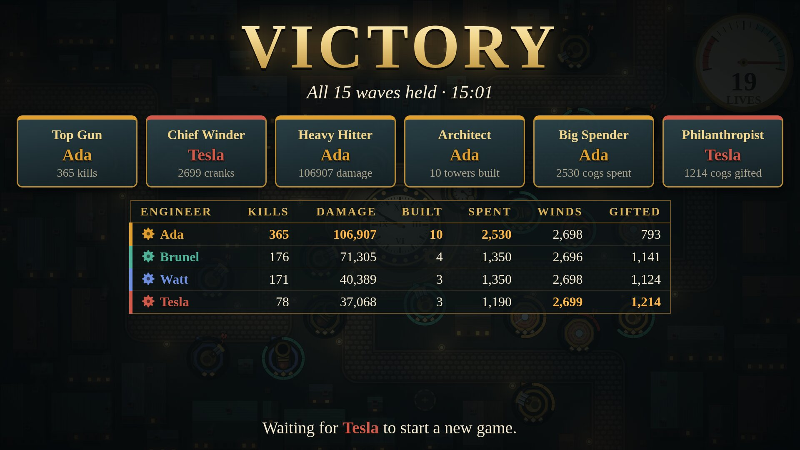

## Sound on the TV

The TV plays sound effects, ambience and music that changes with the phase of the game. On the TV's keyboard:

- `M` mutes and unmutes.
- `[` and `]` lower and raise the volume.

Browsers will not play sound until the page has had a key press or a click, so a "Sound is off" hint shows until then. Press any key once, or allow autoplay for the site (see [the kiosk note in RUNNING.md](RUNNING.md#tv-kiosk)).

## Playing solo and in a crowd

The game is tuned for four, but it works from one player to eight. Starting cogs and income are split, so total team money does not depend on player count. Extra players mean extra hands for cranking and more decisions in parallel, and enemy health rises slightly per extra player to match. Playing solo, you do all the building and cranking yourself.
